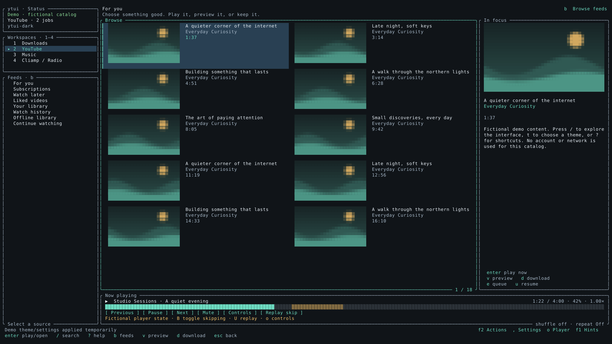

# ytui

A Rust terminal app for YouTube, YouTube Music, downloads and radio. The interface
uses Lazygit-style panes, keyboard navigation, inline thumbnails and mpv playback.
CachyOS + Caelestia + Ghostty + Brave Origin is the primary desktop target.

This is the **0.2.0-alpha.12 candidate** ([audit fixes and acceptance](docs/AUDIT_IMPLEMENTATION.md)). Live account and desktop acceptance remains open;
[remaining work](docs/REMAINING_WORK.md) lists unsupported features and service limits.

```bash
git clone --branch fix/audit-implementation https://github.com/Vanir20342222/ytui.git
cd ytui
./install.sh
ytui doctor
ytui
```

The installer builds Rust and installs both `ytui` and the compatible `ytui-rs`
launcher. Install current stable Rust, a C compiler, pkg-config, OpenSSL headers,
mpv and FFmpeg first. On CachyOS/Arch:

```bash
sudo pacman -S --needed base-devel rustup openssl mpv ffmpeg nodejs
rustup default stable
```

Until this change reaches main, use the `fix/audit-implementation` branch.
Pulling source alone does not replace an installed binary: rerun `./install.sh`
and check `~/.local/bin/ytui --version`. `install-rust.sh` is a compatibility alias.

- `1`–`4`: Downloads, YouTube, Music, Radio. `b`: feeds; `/`: search; `?`: help.
- `Enter`: play/open; `v`: short muted mpv preview; `d`: download options.
- `,`: general settings window; `F2`: searchable Actions; `F1`: toggle bottom hints. PgUp/PgDn changes sections;
  F6 focuses categories; arrows edit choices; Space toggles; Enter saves; Esc cancels.
- `F2 → Account`: import a selected local browser session. Personal feeds need sign-in;
  anonymous Home may have no recommendations.
- `F2 → Player`: actual formats, audio/subtitle choices, SponsorBlock status; `F2 → Settings`: setup, thumbnail cache and safe support export.
- `F2 → Downloads`: full-collection individual jobs, per-entry retry/files and recent destinations.
- `u`: explicit local playback resume; `p`: playback queue.
- `ytui --demo`: fictional catalog for UI review; `ytui --offline`: local library.
- `ytui doctor --network`: opt-in public provider diagnostics without importing an account.
- `ytui playback-check URL --backend native`: check three seconds of actual mpv playback without browser cookies.

Playback now defaults to **native Rust**, using updated pinned
[yt-dlp-rs](https://github.com/aagedal/yt-dlp-rs). Installed Node.js 22+ (or Deno
2.9.7) solves its offline JavaScript challenges. Playback preserves native stream
headers, accepts HLS manifests, and refreshes an interrupted native URL once.
It never starts Python automatically in native mode. **Settings → Playback →
Playback backend** selects native, auto or external yt-dlp explicitly; downloads
retain their separate `auto` default. Install `yt-dlp` separately if you choose
fallback or external extraction. Existing explicit playback choices are retained.
Successful live access still depends on the account/network; a 99% watching
success rate is **not established**. See [current playback evidence](docs/SINGLE_VIDEO_SWEEP.md)
and [CI diagnosis](docs/CI_PLAYBACK_DIAGNOSIS.md).

Playlist links select collection downloads automatically; watch links with playlist
context stay single-video unless explicitly expanded. Playlist jobs retain their
source across entry metadata/retries, and auto uses yt-dlp for native playlist limits.
[Playback/playlist fixes and validation boundaries](docs/PLAYBACK_REPAIR.md).
Downloads preserve valid outputs after malformed later records and reject empty
files. Preview controls preserve saved player preferences; service/tool/storage
failures show contextual recovery steps.

Thumbnails use sized memory/disk caches and nearby prefetch. Feeds load continuation
pages near the end and recover temporary errors automatically, keeping visible
videos and selection. Fresh HTML Home data saves an extra request; overlapping
pages no longer end the feed immediately. Bounded feed/radio/stream caches reuse
recent requests; explicit refresh invalidates cached feeds. Server categories and
section labels remain. Wide cards get most of the width, with square Music art.
`o` opens player controls; **g in mpv**
opens its window menu. Volume/mute persist. `B` toggles SponsorBlock skipping and `U`
replays a skipped part; Settings → Playback controls categories and skip/mark/off.

Rust migration reads existing legacy settings, profiles and queues on request:
`ytui migrate` previews; `ytui migrate --apply` imports with backups. Existing
user files and downloaded media are retained. The old Python source is available
in Git history.

[Documentation index](docs/README.md) · [Usage and settings](docs/RUST.md) · [Remaining work](docs/REMAINING_WORK.md) ·
[Current app audit and backlog](docs/APP_AUDIT_2026-10-22.md) ·
[Feature audit](docs/FEATURE_AUDIT.md) · [Validation](docs/VALIDATION.md) ·
[WQHD theme gallery](docs/UI_THEMES.md) · [Rewrite plan](RUST_REWRITE_PLAN.md)



Run checks with `cargo fmt --all -- --check`,
`cargo clippy --workspace --all-targets --locked -- -D warnings` and
`cargo test --workspace --locked`. The separate real-media fixture and opt-in
live YouTube tests are described in the validation record.
Run `tools/test-youtube.sh auto` for isolated public browsing, playback and
two-entry playlist checks; [live test instructions](docs/LIVE_YOUTUBE_TESTS.md)
describe the required tools, optional public fixture URLs and CI runner.

Generate WQHD captures entirely in Rust:

```bash
cargo build -p ytui --locked
cargo run -p ytui --example capture_ui --locked -- --binary target/debug/ytui
```

The capture tool runs the actual executable in an isolated PTY with fictional
content. No real account or desktop is captured. A monospaced TTF font is required;
pass `--font /path/to/your/font.ttf` if DejaVu Sans Mono is installed elsewhere.

Licensed under MIT. See [third-party notices](THIRD_PARTY_NOTICES.md).
