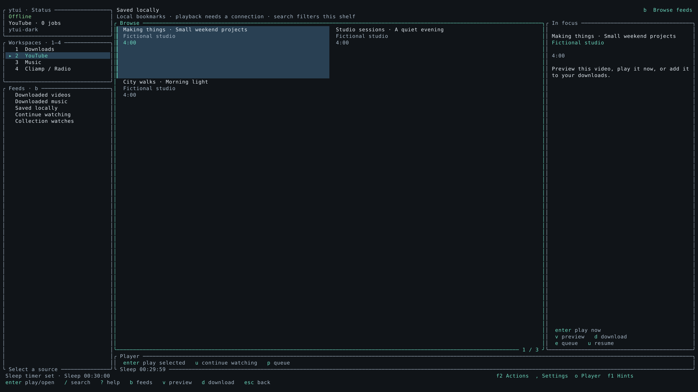
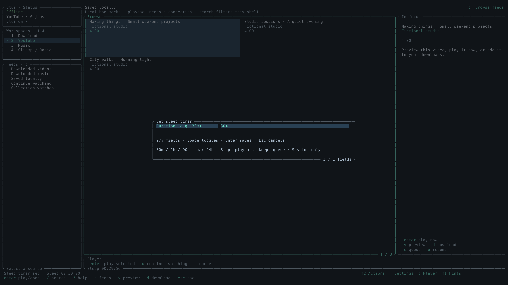

# Researched library and playback features — 24 October 2026 (M4/M5/M7/M8)

## Sources and selection

| Source inspected | Relevant behavior | ytui decision |
| --- | --- | --- |
| [FreeTube README](https://github.com/FreeTubeApp/FreeTube/blob/development/README.md#features) and its “How does it work?” section | Searchable local subscriptions/playlists/history, separate from a Google account. | Add a small local saved-video/song shelf. Keep it separate from the existing signed-in Watch Later feed and account imports. |
| [YouTube TUI README](https://github.com/Siriusmart/youtube-tui#powerful) | Search filters, history and an offline library; its TODO includes channel caching/bookmarking. | Make the shelf searchable and available through the normal feed picker and a remappable shortcut. Bookmarking in this source is a backlog idea, not evidence of an implemented upstream bookmark feature. |
| [mpv input manual](https://github.com/mpv-player/mpv/blob/master/DOCS/man/input.rst) — `stop` and array commands | Stop terminates playback; client commands have explicit typed arguments. | Build a session sleep timer around ytui's existing Rust player actor and Stop command. Keep the durable ytui queue, suppress automatic advance and keep the terminal app open. |

These were chosen because they improve daily browsing/listening without another
service or extractor dependency. The implementation uses ytui's existing Rust
models, private state store, UI and player controller. Server-side YouTube search
filters and transcripts remain separate candidates: their request/caption
behavior needs live provider qualification, which the current cloud YouTube
failures cannot establish. No account mutation or automatic cookie import was
added.

## Saved locally

- Select a YouTube video or song and press **S**, or choose **F2 → Library →
  Save / remove selected video or song locally**. The shortcut is remappable.
- Open **Saved locally** in the feed picker or Library actions. **/** searches
  the shelf by title, creator or video ID. Blank search shows all entries, newest
  first. The entry is available in offline mode for reviewing metadata.
- Saved links are bookmarks, so playback still needs a connection. Downloaded
  files remain in Offline library. Station Favorites and remote Watch Later keep
  their existing routes. This first shelf accepts individual videos/songs.
- Watch, youtu.be, Shorts, live and embed aliases share an identity. Persist only
  a stable watch URL; remove tracking, timestamps and playlist context. Preserve
  audio/video intent across playback, queueing, downloads, recent folders and
  explicit fallback, even when the shelf is opened in a different tab.
- State survives restart and account disconnect. Existing snapshots default to an
  empty shelf. No SQLite schema version change is needed. Large remote text and
  thumbnail choices are trimmed; limits are 500 items and a four-MiB retained-data
  estimate. A full shelf reports an error instead of silently evicting entries.

## Sleep timer

Open **o → Set sleep timer** (also in F2 → Player). Enter `30m`, `1h`, or `90s`,
from one second to 24 hours. The player strip shows the countdown; status and
cancel actions are in the same Player menu. The timer applies across pauses and
track/station changes. It is session-only and starts disabled after restarting.

Expiry sends Stop, retains the queue and existing resume records, and prevents
an EOF event from automatically advancing it. A full player command channel is
retried; an unavailable worker reports failure instead of claiming a successful
stop. A late EOF or explicit playback/preview/fallback request cannot slip past
a pending timer stop. Idle countdown redraws are limited to changed seconds.
The timer stops playback without quitting ytui; downloads are unaffected.

## Verification

- **254 deterministic workspace tests passed**, with 29 opt-in checks excluded.
  This adds 23 ordinary tests plus one opt-in actual-player test to the reviewed
  main baseline. Formatting and strict all-target Clippy pass.
- **11 actual local media checks passed**, including the new app → real mpv
  timer-expiry journey using synthetic audio and null outputs. One isolated
  D-Bus MPRIS check passes separately.
- Saved-state restart/old snapshot compatibility, alias identity, size bounds,
  Unicode search, remapping/input focus and account disconnect have regressions.
  Timer tests cover exact expiry, cancellation/rearm, rejected duration changes,
  worker backpressure/closure and EOF arriving before the next UI tick.
- Shelf, timer form and timer status render across both languages, 13 themes and
  five terminal sizes: 390 feature render states. The actual executable PTY test
  removes a saved item, verifies it stays removed after shutdown, and exercises
  timer setup/status/cancel offline. New English/German labels are bundled.
- Two native PTY captures bring the checked WQHD gallery to **63** images, all
  2560×1440 and manifest-registered. Fixtures are fictional; no provider/cookie,
  physical Ghostty or audible-output acceptance is claimed by those captures.

GitHub's Rust workflow also runs the new actual mpv timer test before its release
build. Existing live YouTube/account/desktop gates remain tracked separately in
[the remaining-work inventory](REMAINING_WORK.md).
