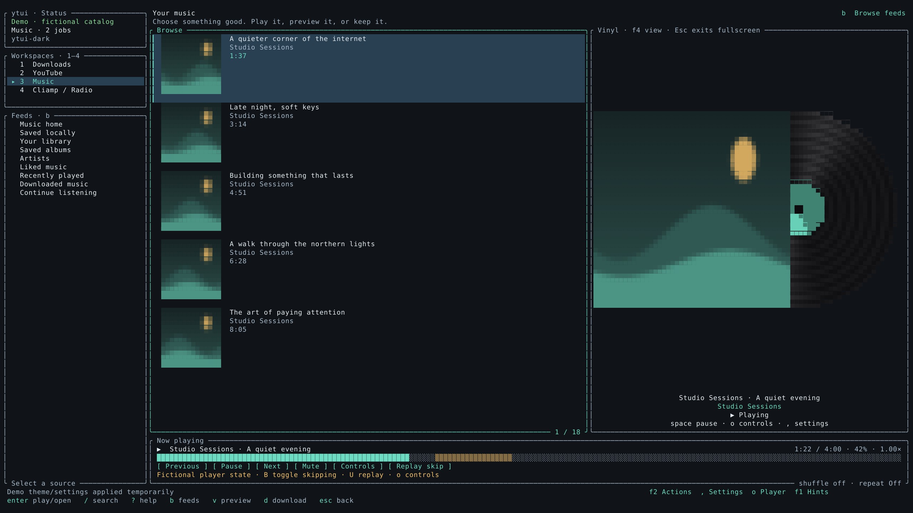
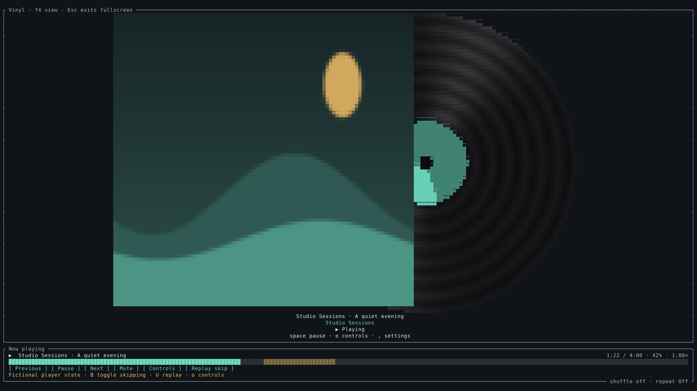

# Vinyl music player (M5/M6/M7/M8)

Music and Cliamp/Radio offer three persistent presentation modes:

- `classic`: existing catalog and selected-item detail view.
- `vinyl`: catalog alongside a sleeve/record panel for the playing song or station.
- `vinyl-fullscreen`: sleeve/record fills the terminal, with the existing transport
  and progress bar below it.

Press **F4** to cycle modes, use **F2 → Cycle music player style**, or choose
**General settings → Appearance → Music player style**. F4 is remappable in
Keyboard bindings. **Esc** leaves fullscreen; **1–4** still switch tabs. Settings,
help and player-control panels work over fullscreen. Downloads and YouTube keep
their existing layouts regardless of the selected music presentation.

The grooves, rotating reflection and label are drawn using terminal half blocks;
no new renderer, animation process or dependency is needed. Rotation advances at
one turn per four seconds while active playback is neither paused nor buffering.
It freezes on pause/stop/buffering, on other tabs, and with Reduced motion enabled.
Resume continues from the frozen angle without catching up elapsed pause time.
The sleeve remains still. Existing space/seek/volume/queue/player controls remain
available; this presentation does not change extraction or playback backends.

Artwork uses the existing sized disk cache and terminal protocol. It follows
`player_status.media`, independently of the highlighted browse item. Missing or
disabled artwork gets a themed sleeve. Native image protocols offer the best
cover detail; half blocks remain available. At narrow widths or with an empty
catalog the vinyl pane occupies the catalog content area. Fullscreen has a
separate explicit mode.

## Validation

Cloud validation on 2026-10-27: **270 workspace tests passed**, with 30 opt-in
cases excluded; formatting and strict all-target Clippy passed. The final groove
shading refinement was rechecked with the five focused UI cases and Clippy.
No playback-service code or dependency was changed.

Deterministic tests cover config migration/roundtrip/invalid styles, Music/Radio
scoping, mode cycling/exit, active-track artwork reuse, all built-in themes,
35×12 / 80×24 / 120×40 / 212×58 layouts, modal overlays, rotation and its freeze
conditions. Fixtures use synthetic demo art and isolated directories; they never
read browser sessions or request public media.

The native capture tool provides actual executable PTY captures at 2560×1440:

```sh
cargo build -p ytui --locked
cargo run -p ytui --example capture_ui --locked -- --vinyl-only
cargo test -p ytui --test vinyl_ui --locked
```




These are fictional demo data and generated covers rendered through half blocks,
not target-PC Ghostty screenshots. The stills illustrate layout; motion is covered
by deterministic clock/state tests. Actual desktop image-protocol and active
network-recovery acceptance remain separately recorded in VALIDATION.md.
