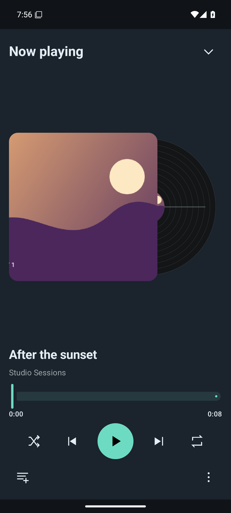
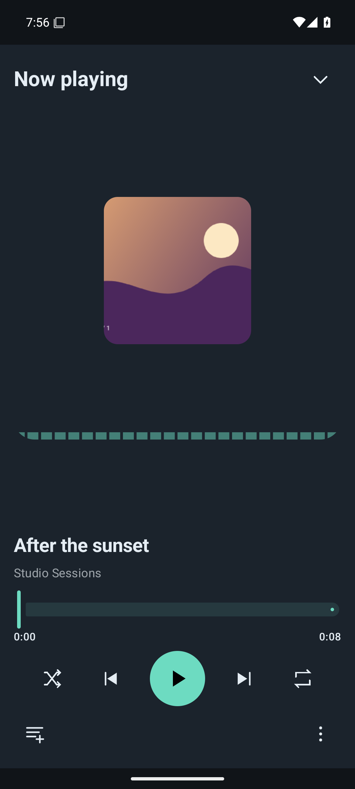
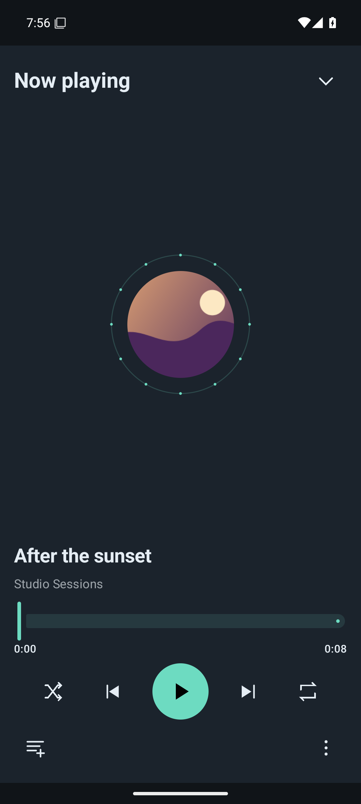
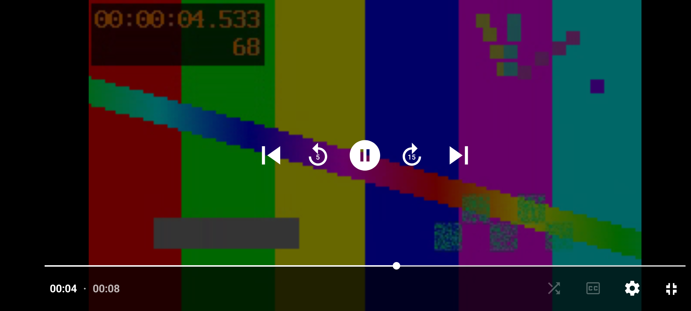

# Android player and library UI

Actual unedited API 35 captures from source `cf8046508b96962f1b5ba9efc3529c4427d64b9f`, [qualified main run](https://github.com/Vanir20342222/ytui/actions/runs/40837593351). Phone views are 1080×2400, tablet 2560×1600, fullscreen 2400×1080. The catalog, artwork and RGB video are original generated offline fixtures, not a personal account or a live YouTube feed. Production uses provider content. No capture has been cropped, resized or retouched.

  

  

[Fullscreen without controls](video-fullscreen.png) · [Visible video after returning](video-return.png) · [Classic player](player.png)

All 13 theme captures, keyboard/account evidence, JUnit and logs are in the [device artifact](https://github.com/Vanir20342222/ytui/actions/runs/40837593351/artifacts/12882181356). It has 24 passing runtime cases, one explicit public-service skip, zero app ANRs and zero Rust panic markers. [Signed APK](https://github.com/Vanir20342222/ytui/releases/download/android-0.2.0-alpha.12-mobile.4/ytui-0.2.0-alpha.12-mobile.4.apk) · [Validation and limits](../../android/PLAYER_LIBRARY_VALIDATION_2026-10-29.md). Emulator rendering does not establish audible output or physical-device/live YouTube acceptance.
