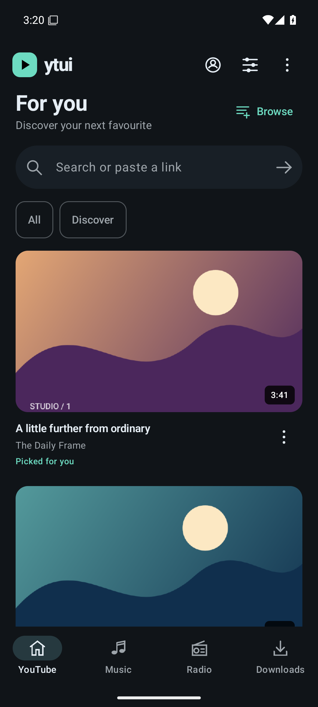
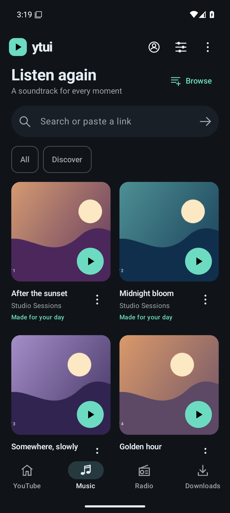
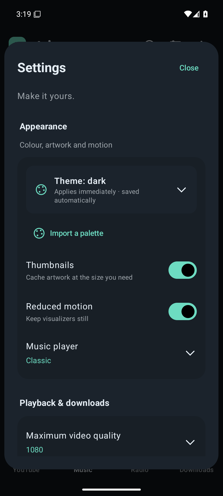
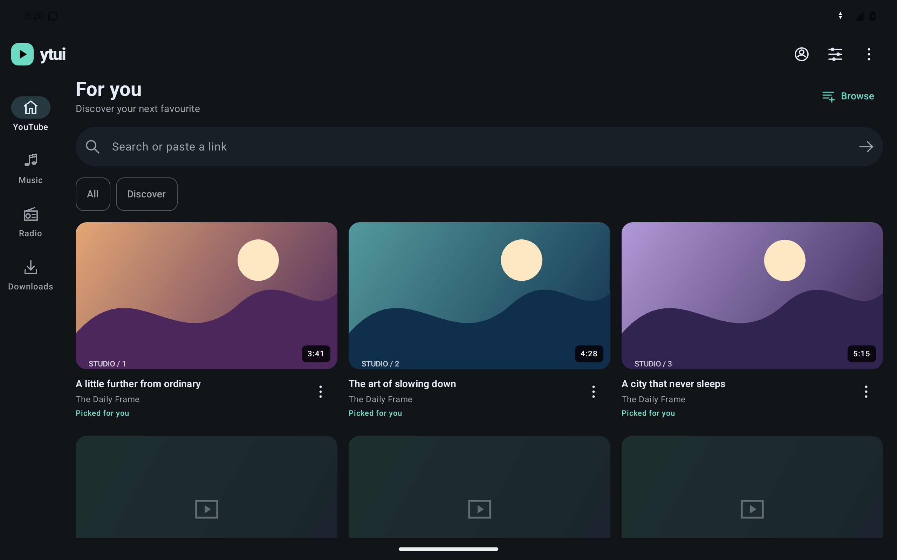

# Android media UI

Actual API 35 emulator captures from tested source `5f34083`, [Android run 40712963078](https://github.com/Vanir20342222/ytui/actions/runs/40712963078). Phone captures are 1080×2400; tablet is 2560×1600. The catalog and covers are original generated offline test fixtures, not a real account or live provider feed. Production screens display provider results and their own artwork. No screenshot has been edited.

  

[Full player capture](player.png). All 13 theme captures, account/keyboard screenshots, logs and JUnit are in the [device evidence](https://github.com/Vanir20342222/ytui/actions/runs/40712963078/artifacts/12828725236). These captures establish emulator rendering, not real YouTube or physical device acceptance.
